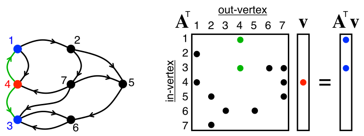

# SuiteSparseGraphBLAS.jl

```@meta
DocTestSetup = :(using SuiteSparseGraphBLAS)
DocTestFilters = [r"memory: \d+ bytes"]
```

Fast sparse linear algebra is an essential part of the scientific computing toolkit. Outside of the usual applications, like differential equations, sparse linear algebra provides an elegant way to express graph algorithms on adjacency and incidence matrices. The GraphBLAS standard specifies a set of operations for computing sparse matrix graph algorithm in a vein similar to the BLAS or LAPACK standards.

SuiteSparseGraphBLAS.jl is a blazing fast package for shared memory sparse matrix operations which wraps Tim Davis' SuiteSparse:GraphBLAS. If you use this package in your research please see [Citing](@ref).

# Installation

Install using the Julia package manager in the REPL:

```
] add SuiteSparseGraphBLAS
```

or with `Pkg`

```
using Pkg
Pkg.add("SuiteSparseGraphBLAS")
```

The SuiteSparse:GraphBLAS binary, SSGraphBLAS_jll.jl, is installed automatically.

Then in the REPL or script `using SuiteSparseGraphBLAS` will make the package available for use.

# Introduction

GraphBLAS harnesses the well-understood duality between graphs and matrices.
Specifically a graph can be represented by the [adjacency matrix](https://en.wikipedia.org/wiki/Adjacency_matrix) and/or [incidence matrix](https://en.wikipedia.org/wiki/Incidence_matrix), or one of the many variations on those formats. 
With this matrix representation in hand we have a method to operate on the graph with linear algebra.

One important algorithm that maps well to linear algebra is Breadth First Search (BFS). 
A simple BFS is just a matrix-vector multiplication, where `A` is the adjacency matrix and `v` is the set of source nodes, as illustrated below.



## GBArrays

The core SuiteSparseGraphBLAS.jl array types are `GBVector` and `GBMatrix` which are subtypes `SparseArrays.AbstractSparseVector` and `SparseArrays.AbstractSparseMatrix` respectively.

!!! note "GBArray"
    These docs will often refer to the `GBArray` type, which is the union of `AbstractGBVector`, `AbstractGBMatrix` and their lazy Transpose objects.

```jldoctest intro
julia> # create a size 13 empty sparse vector with Float64 elements.
       v = GBVector{Float64}(13)
13x1 GraphBLAS double matrix, sparse by col, ints: 32/32/32
  no entries, memory: 248 bytes

julia> # create a 1000 x 1000 empty sparse matrix with ComplexF64 elements.
       A = GBMatrix{ComplexF64}(1000, 1000)
1000x1000 GraphBLAS double complex matrix, hypersparse by row, ints: 32/32/32
  no entries, memory: 256 bytes

julia> # Non-stored values are equal to the fill value of A,
       # which is by default zero(eltype(A))
       A[1,5] == getfill(A)
true
```

Here we can already see several differences compared to `SparseArrays.SparseMatrixCSC`.

The first is that `A` is stored in `hypersparse` format, and by row.

`GBArrays` are (technically) opaque to the user in order to allow the library author to choose the best storage format.\
SuiteSparse:GraphBLAS takes advantage of this by storing matrices in one of four formats: `dense`, `bitmap`, `sparse-compressed`, or `hypersparse-compressed`; and in either `row` or `column` major orientation.\
Different matrices may be better suited to storage in one of those formats, and certain operations may perform differently on `row` or `column` major matrices.

!!! warning "Default Orientation"
    The default orientation of a `GBMatrix` is by-row, the opposite of Julia arrays. However, a `GBMatrix` constructed from a `SparseMatrixCSC` or 
    `Matrix` will be stored by-column.\
    The orientation of a `GBMatrix` can be modified using
    `setstorageorder!(A, RowMajor())` or `setstorageorder!(A, ColMajor())`, and queried by `StorageOrders.storageorder(A)`

Information about storage formats, orientation, conversion, construction and more can be found in [Array-Types](@ref).

As noted in the example above, `A` has a fill-value, which defaults to `zero(eltype(A))`.
For normal linear algebra this is a good choice for fill-value, however GraphBLAS is intended for graphs.
To handle this `SuiteSparseGraphBLAS.jl` support `missing` for the fill value (this is an active area of development, and a new fill value that acts like the identity for most operations is better suited to this task).

```jldoctest intro
julia> A[1, 1] == zero(eltype(A))
true

julia> B = setfill(A, missing) # no-copy alias
1000x1000 GraphBLAS double complex matrix, hypersparse by row, ints: 32/32/32
  no entries, memory: 256 bytes

julia> B[1, 1]
missing
```

An empty matrix and vector won't do us much good, so let's see how to construct the matrix and vector from the graphic above. Both `A` and `v` below are constructed from coordinate format or COO.

```jldoctest intro
julia> A = GBMatrix([1,1,2,2,3,4,4,5,6,7,7,7], [2,4,5,7,6,1,3,6,3,3,4,5], [1:12...])
7x7 GraphBLAS int64_t matrix, bitmap by row
  12 entries, memory: 681 bytes

    (1,2)   1
    (1,4)   2
    (2,5)   3
    (2,7)   4
    (3,6)   5
    (4,1)   6
    (4,3)   7
    (5,6)   8
    (6,3)   9
    (7,3)   10
    (7,4)   11
    (7,5)   12

julia> v = GBVector([4], [10], 7)
7x1 GraphBLAS int64_t matrix, bitmap by col
  1 entry, memory: 304 bytes

    (4,1)   10
```

## GraphBLAS Operations

The complete documentation of supported operations can be found in [Operations](@ref).
GraphBLAS operations are, where possible, methods of existing Julia functions listed in the third column.

| GraphBLAS           | Operation                                                                         | Julia                                      |
|:--------------------|:----------------------------------------:                                         |----------:                                 |
|`mxm`, `mxv`, `vxm`  |``\bf C \langle M \rangle = C \odot AB``                                           |`mul!` or `*`                               |
|`eWiseMult`          |``\bf C \langle M \rangle = C \odot (A \otimes B)``                                |`emul[!]` or `.` broadcasting               |
|`eWiseAdd`           |``\bf C \langle M \rangle = C \odot (A \oplus  B)``                                |`eadd[!]`                                   |
|`eWiseUnion`         |``\bf C \langle M \rangle = C \odot ([ A \vert \alpha ] \oplus [ B \vert \beta ])``|`eunion[!]`                                 |
|`extract`            |``\bf C \langle M \rangle = C \odot A(I,J)``                                       |`extract[!]`, `getindex`                    |
|`subassign`          |``\bf C (I,J) \langle M \rangle = C(I,J) \odot A``                                 |`subassign[!]` or `setindex!`               |
|`assign`             |``\bf C \langle M \rangle (I,J) = C(I,J) \odot A``                                 |`assign[!]`                                 |
|`apply`              |``{\bf C \langle M \rangle = C \odot} f{\bf (A)}``                                 |`apply[!]`, `map[!]` or `.` broadcasting    |
|                     |``{\bf C \langle M \rangle = C \odot} f({\bf A},y)``                               |                                            |
|                     |``{\bf C \langle M \rangle = C \odot} f(x,{\bf A})``                               |                                            |
|                     |``{\bf C \langle M \rangle = C \odot} f({\bf A}_{ij}, i, j, x)``                   |                                            |
|`select`             |``{\bf C \langle M \rangle = C \odot} f({\bf A}_{ij},i, j, x)``                    |`select[!]`                                 |
|`reduce`             |``{\bf w \langle m \rangle = w \odot} [{\oplus}_j {\bf A}(:,j)]``                  |`reduce[!]`                                 |
|                     |``s = s \odot [{\oplus}_{ij}  {\bf A}(i,j)]``                                      |                                            |
|`transpose`          |``\bf C \langle M \rangle = C \odot A^{\sf T}``                                    |`gbtranspose[!]`, lazy: `transpose`, `'`    |
|`kronecker`          |``\bf C \langle M \rangle = C \odot \text{kron}(A, B)``                            |`kron[!]`                                   |

where ``\bf M`` is a `GBArray` mask, ``\odot`` is a binary operator for accumulating into ``\bf C``, and ``\otimes`` and ``\oplus`` are a binary operation and commutative monoid respectively. ``f`` is either a unary or binary operator. 

## GraphBLAS Operators

Many GraphBLAS operations take additional arguments called *operators*. In the table above operators are denoted by ``\odot``, ``\otimes``, and ``\oplus`` and ``f``, and they behave similar to the function argument of `map`. A closer look at operators can be found in [Operators](@ref)

A GraphBLAS operator is a unary or binary function, the commutative monoid form of a binary function,
or a semiring, made up of a binary op and a commutative monoid.
SuiteSparse:GraphBLAS ships with many of the common unary and binary operators as built-ins,
along with monoids and semirings built commonly used in graph algorithms. 
These built-in operators are *fast*, and should be used where possible. However, users are also free to provide their own functions as operators when necessary.

SuiteSparseGraphBLAS.jl will take care of operators behind the scenes, and in most cases users should pass in normal functions like `+` and `sin`. For example:

```jldoctest intro
julia> emul(A, A, ^) # elementwise exponent
7x7 GraphBLAS int64_t matrix, bitmap by row
  12 entries, memory: 681 bytes

    (1,2)   1
    (1,4)   4
    (2,5)   27
    (2,7)   256
    (3,6)   3125
    (4,1)   46656
    (4,3)   823543
    (5,6)   16777216
    (6,3)   387420489
    (7,3)   10000000000
    (7,4)   285311670611
    (7,5)   8916100448256

julia> map(sin, A)
7x7 GraphBLAS double matrix, bitmap by row
  12 entries, memory: 681 bytes

    (1,2)    0.841471
    (1,4)    0.909297
    (2,5)    0.14112
    (2,7)    -0.756802
    (3,6)    -0.958924
    (4,1)    -0.279415
    (4,3)    0.656987
    (5,6)    0.989358
    (6,3)    0.412118
    (7,3)    -0.544021
    (7,4)    -0.99999
    (7,5)    -0.536573
```

Broadcasting functionality is also supported, `A .^ A` will lower to `emul(A, A, ^)`, and `sin.(A)` will lower to `apply(sin, A)`.

Matrix multiplication, which accepts a semiring, can be called with either `*(max, +)(A, B)`,
`*(A, B, (max, +))`, or `LinearAlgebra.mul!(C, A, B, (max, +))`.

We can also use functions that are not already built into SuiteSparseGraphBLAS.jl:

```jldoctest intro
julia> M = GBMatrix([[1,2] [3,4]])
2x2 GraphBLAS int64_t matrix, full by col
  4 entries, memory: 272 bytes

    (1,1)   1
    (2,1)   2
    (1,2)   3
    (2,2)   4

julia> increment(x) = x + 1
increment (generic function with 1 method)

julia> map(increment, M)
2x2 GraphBLAS int64_t matrix, full by col
  4 entries, memory: 272 bytes

    (1,1)   2
    (2,1)   3
    (1,2)   4
    (2,2)   5
```

Unfortunately this has a couple problems. The first is that it's slow.\
Compared to `A .+ 1` which lowers to `apply(+, A, 1)` the `map` call above is ~2.5x slower due to function pointer overhead.

!!! warning "Performance of User Defined Functions"
    Operators which are not already built-in are automatically constructed using function pointers when called. 
    Their performance is significantly degraded compared to built-in operators,
    and where possible user code should avoid this capability and instead compose built-in operators. See [Operators](@ref).

## Example

Here is a quick example of two different methods of triangle counting with GraphBLAS.
The methods are drawn from the LAGraph [repo](https://github.com/GraphBLAS/LAGraph).

Input `A` must be a square, symmetric matrix with any element type.
We'll test it using the matrix from the GBArray section above, which has two triangles in its undirected form.

```jldoctest intro
julia> using SuiteSparseGraphBLAS: pair

julia> function cohen(A)
         U = select(triu, A)
         L = select(tril, A)
         return reduce(+, *(L, U, (+, pair); mask=A)) ÷ 2
       end
cohen (generic function with 1 method)

julia> function sandia(A)
         L = select(tril, A)
         return reduce(+, *(L, L, (+, pair); mask=L))
       end
sandia (generic function with 1 method)

julia> M = eadd(A, A', +) #Make undirected/symmetric
7x7 GraphBLAS int64_t matrix, bitmap by row
  20 entries, memory: 681 bytes

    (1,2)   1
    (1,4)   8
    (2,1)   1
    (2,5)   3
    (2,7)   4
    (3,4)   7
    (3,6)   14
    (3,7)   10
    (4,1)   8
    (4,3)   7
    (4,7)   11
    (5,2)   3
    (5,6)   8
    (5,7)   12
    (6,3)   14
    (6,5)   8
    (7,2)   4
    (7,3)   10
    (7,4)   11
    (7,5)   12

julia> cohen(M)
2

julia> sandia(M)
2
```

# Citing

Please cite the following papers if you use SuiteSparseGraphBLAS.jl in your work:

[pdf](https://doi.org/10.1145/3322125):
```bibtex
    @article{10.1145/3322125,
    author = {Davis, Timothy A.},
    title = {Algorithm 1000: SuiteSparse:GraphBLAS: Graph Algorithms in the Language of Sparse Linear Algebra},
    year = {2019},
    issue_date = {December 2019},
    publisher = {Association for Computing Machinery},
    address = {New York, NY, USA},
    volume = {45},
    number = {4},
    issn = {0098-3500},
    url = {https://doi.org/10.1145/3322125},
    doi = {10.1145/3322125},
    journal = {ACM Trans. Math. Softw.},
    month = {dec},
    articleno = {44},
    numpages = {25},
    keywords = {GraphBLAS, Graph algorithms, sparse matrices}
    }
```

[pdf](https://github.com/DrTimothyAldenDavis/GraphBLAS/blob/stable/Doc/toms_parallel_grb2.pdf):
```bibtex
    @article{GraphBLAS7,
    author = {Davis, Timothy A.},
    title = {Algorithm 10xx: SuiteSparse:GraphBLAS: Graph Algorithms in the Language of Sparse Linear Algebra},
    year = {2022},
    journal = {ACM Trans. Math. Softw.},
    month = {(under revision)},
    note={See GraphBLAS/Doc/toms_parallel_grb2.pdf},
    keywords = {GraphBLAS, Graph algorithms, sparse matrices}
}
```

[pdf](https://ieeexplore.ieee.org/stamp/stamp.jsp?arnumber=9622789&casa_token=VPmmUD8cdFcAAAAA:NYSm3tdjrBwF53rJxo9PqVRWzXY41hE6l1MoKpBqqZC0WESFPGx6PtN1SjVf8M4x01vfPrqU&tag=1):
```bibtex
@inproceedings{9622789,
author={Pelletier, Michel and Kimmerer, Will and Davis, Timothy A. and Mattson, Timothy G.},
booktitle={2021 IEEE High Performance Extreme Computing Conference (HPEC)},
title={The GraphBLAS in Julia and Python: the PageRank and Triangle Centralities},
year={2021},
pages={1-7},
doi={10.1109/HPEC49654.2021.9622789},
ISSN={2643-1971},
month={Sep.}
}
```
